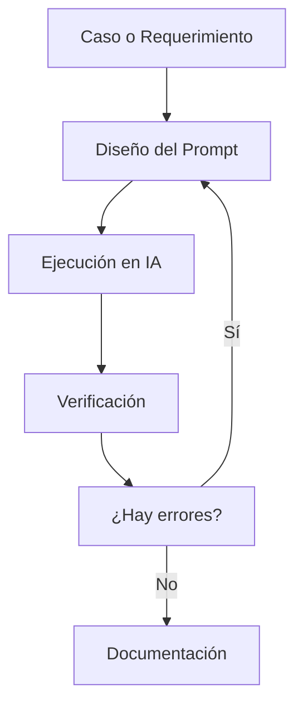

# Evaluación 02: Diseño de Interfaces de Programación Avanzado

Documentación sobre diseño de prompts, uso de modelos de IA, extracción de datos y comparación de herramientas.

## ÍNDICE

1. Pregunta 1: ChatGPT - Anatomía de un prompt efectivo
2. Pregunta 2: Claude - Razonamiento y costos
3. Pregunta 3: IA Libre - Extracción de datos
4. Pregunta 4: Flujo y conclusión

---

# Pregunta 1: ChatGPT - Anatomía de un prompt efectivo

## 1. Componentes del prompt

| Componente    | Descripción                                                      |
| ------------- | ---------------------------------------------------------------- |
| Rol           | Analista de Producto y Atención al Cliente de RutaFácil.         |
| Contexto      | Reseñas de clientes sobre pedidos, pagos y atención.             |
| Tarea         | Clasificar las reseñas y encontrar los problemas más frecuentes. |
| Formato       | Tabla y 3 acciones prioritarias.                                 |
| Restricciones | Usar solamente la información de las 8 reseñas.                  |

## 2. Prompt utilizado

```text
Actúa como un Analista de Producto y Atención al Cliente de la startup RutaFácil.

Analiza las siguientes 8 reseñas:

1. El pedido llegó 50 minutos tarde y la comida fría.
2. La app se cerró dos veces al pagar con Yape.
3. El repartidor fue muy amable, todo perfecto.
4. Tercera vez que mi pedido llega tarde este mes.
5. El costo de envío subió a S/ 9, es demasiado.
6. No puedo ver el seguimiento del pedido en el mapa.
7. Llegó con una hora de retraso y faltaba una bebida.
8. Escribí al chat de soporte y nadie respondió en 2 días.

Clasifica los problemas, indica la cantidad de casos y coloca un ejemplo.

Después, indica 3 acciones prioritarias.

No inventes información y utiliza solamente las reseñas proporcionadas.
```

---

# Pregunta 2: Claude - Razonamiento y costos

## Datos

* 4,000 consultas por día.
* 30 días.
* Total: 120,000 consultas al mes.
* Entrada actual: 1,200 tokens.
* Entrada optimizada: 700 tokens.
* Salida: 300 tokens.
* Entrada: US$ 3 por millón de tokens.
* Salida: US$ 15 por millón de tokens.
* Presupuesto: US$ 900.

## Costo actual

Entrada:

```text
120,000 × 1,200 = 144,000,000 tokens
```

Costo:

```text
144 × 3 = US$ 432
```

Salida:

```text
120,000 × 300 = 36,000,000 tokens
```

Costo:

```text
36 × 15 = US$ 540
```

**Costo total: US$ 972**

## Costo optimizado

Entrada:

```text
120,000 × 700 = 84,000,000 tokens
```

Costo:

```text
84 × 3 = US$ 252
```

Salida:

```text
120,000 × 300 = 36,000,000 tokens
```

Costo:

```text
36 × 15 = US$ 540
```

**Costo total: US$ 792**

## Ahorro

```text
US$ 972 - US$ 792 = US$ 180
```

**Ahorro: 18.52 %**

| Escenario  |   Costo | Presupuesto | Cumple |
| ---------- | ------: | ----------: | ------ |
| Actual     | US$ 972 |     US$ 900 | No     |
| Optimizado | US$ 792 |     US$ 900 | Sí     |

---

# Pregunta 3: IA Libre - Extracción de datos

## Formato utilizado

```json
{
  "nombre": "string",
  "puesto": "string",
  "anios_experiencia": "number",
  "tecnologias": ["string"],
  "disponibilidad": "string",
  "pretension_soles": "number | null"
}
```

## Ejemplos

### Ejemplo 1

Entrada:

> Hola, soy Carlos Gómez, postulo a DevOps. Tengo 2 años con AWS y Linux. Pretendo 3500 soles. Puedo iniciar mañana.

Salida:

```json
{
  "nombre": "Carlos Gómez",
  "puesto": "DevOps",
  "anios_experiencia": 2,
  "tecnologias": ["AWS", "Linux"],
  "disponibilidad": "Mañana",
  "pretension_soles": 3500
}
```

### Ejemplo 2

Entrada:

> Saludos, mi nombre es Ana Torres para Diseñadora UX. Llevo año y medio en Figma. Disponibilidad inmediata.

Salida:

```json
{
  "nombre": "Ana Torres",
  "puesto": "Diseñadora UX",
  "anios_experiencia": 1.5,
  "tecnologias": ["Figma"],
  "disponibilidad": "Inmediata",
  "pretension_soles": null
}
```

### Ejemplo 3

Entrada:

> Buenas, me llamo Juan Perez, programador Java con 4 años de experiencia en Spring Boot. Disponible en 15 días.

Salida:

```json
{
  "nombre": "Juan Perez",
  "puesto": "Programador Java",
  "anios_experiencia": 4,
  "tecnologias": ["Spring Boot"],
  "disponibilidad": "En 15 días",
  "pretension_soles": null
}
```

## Resultado

```json
[
  {
    "nombre": "Rosa Quispe",
    "puesto": "Desarrolladora Backend",
    "anios_experiencia": 3,
    "tecnologias": ["Python", "Django", "Docker"],
    "disponibilidad": "1 de diciembre",
    "pretension_soles": 4500
  },
  {
    "nombre": "Diego Ramírez",
    "puesto": "Frontend",
    "anios_experiencia": 1.5,
    "tecnologias": ["React", "TypeScript"],
    "disponibilidad": "Inmediata",
    "pretension_soles": null
  },
  {
    "nombre": "Lucía Fernández",
    "puesto": "QA Automation",
    "anios_experiencia": 5,
    "tecnologias": ["Selenium", "Cypress", "Java"],
    "disponibilidad": "En dos semanas",
    "pretension_soles": 6000
  }
]
```

---

# Pregunta 4: Flujo y conclusión

## Flujo



## Conclusión

En esta evaluación aprendí que un prompt bien hecho ayuda a obtener mejores respuestas de la IA. También pude comprobar que reducir la cantidad de tokens puede disminuir los costos. En el caso de EduTech, el costo bajó de US$ 972 a US$ 792, logrando un ahorro de 18.52 %.

También aprendí que los ejemplos Few-Shot ayudan a que la IA entienda mejor el formato que necesitamos para organizar los datos.
